# 📞 Memory Phone ⏳

An old rotary phone that plays the past. Lift the receiver, dial a year, and hear voice notes from family and friends about that year.

Friends and family can keep adding messages from a simple web page, either straight away or locked until a future date. When something new arrives, the dial tone stutters. Dial `*` to hear it. 📬

I built this for my wife's birthday with a Raspberry Pi Zero 2 W, a reproduction rotary phone and a lot of help from AI. 🤖☕ The full story, with photos and everything that went wrong, is on Substack: [link]

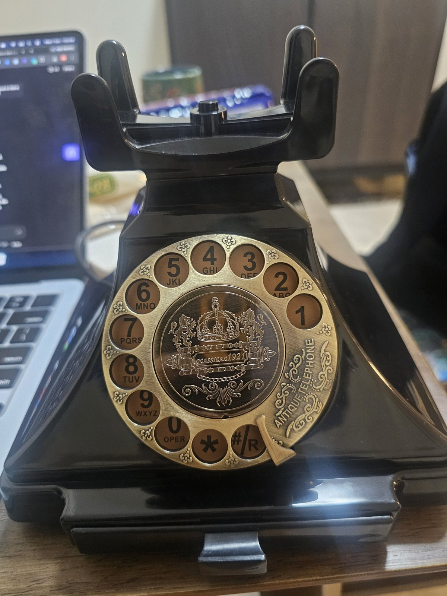

## 🎛️ How it works

| Do this | What happens |
|---|---|
| Lift the receiver | Dial tone. A stuttering tone means new messages are waiting |
| Dial a year, e.g. `1998`, then wait 4 seconds | Plays every message for that year, one after another |
| Dial `*` | Plays new messages. If nothing is new, plays the latest one |
| Dial `#` | Plays the latest message |
| Dial a number with nothing on it | "Number not in service" tone |
| Put the receiver down | Stops |

## 🗂️ What's in here

| Folder | What it is |
|---|---|
| `phone/` | Everything that runs on the Raspberry Pi |
| `web/` | The web app guests use to record messages, hosted on Fly.io |
| `photos/` | Build photos |

| File | What it does |
|---|---|
| `phone/phone.py` | The phone. Reads the hook and dial, plays the audio. Runs on a laptop too with `--sim` |
| `phone/wire_test.py` | Helps you work out which of the phone's wires is the hook and which is the dial |
| `phone/convert_clips.sh` | Turns voice notes into clean, volume-matched clips and skips duplicates |
| `phone/make_sounds.sh` | Generates the dial tone, stutter tone and "not in service" tone |
| `phone/sync.py` | Downloads new messages from the web app |
| `phone/*.service`, `phone/sync.timer` | Start the phone on boot and sync every hour |
| `web/app.py` | The recording page, admin page and the API the phone syncs from |
| `web/DEPLOY.md` | Step-by-step deploy guide for the web app |

## 🛒 Parts

| Part | Notes |
|---|---|
| Reproduction rotary phone | Any phone with a pulse dial and a handset on a hook works |
| Raspberry Pi Zero 2 W | Small enough to hide inside, has Wi-Fi |
| microSD card, 16GB or more | |
| 2x20 male header pins | Unless you buy a Pi with pins already soldered |
| USB sound card | The Pi Zero has no audio jack. I used a Vention one |
| Micro USB OTG adapter | Lets the sound card plug into the Pi |
| 3.5mm audio cable | Cut open and wired to the earpiece |
| Female jumper wires | So you can plug onto the Pi's pins |
| Soldering iron, solder, desoldering pump | You will need the pump. Trust me 🫠 |
| Multimeter | Optional, but saves you from guessing 🔍 |
| 5V phone charger and micro USB cable | Power |

No amplifier needed. The USB sound card drives the earpiece directly. 🔊

## 🔌 Wiring

Disconnect the dial, hook switch and handset from the phone's own circuit board first. ✂️

| Phone wire | Raspberry Pi pin |
|---|---|
| Hook switch, one wire | Pin 11 (GPIO17) |
| Hook switch, other wire | Pin 9 (GND) |
| Dial pulse contact, one wire | Pin 15 (GPIO22) |
| Dial pulse contact, other wire | Pin 14 (GND) |
| Earpiece | USB sound card, via the 3.5mm cable: left channel to one earpiece wire, ground to the other |

You only need to solder the pins you use. I did 1, 2, 6, 9, 11, 13, 14, 15, 16, 39 and 40. Pin 16 was an accident. 🙃

⚠️ **Don't let solder bridge pins 1 and 2.** That joins 3.3V and 5V and can fry the Pi. Ask me how I know. 🔥

**Finding the right wires.** My dial had three wires. One pair clicks once per pulse (that's the one you want). Another pair stays open for the whole time the dial is turning (called "off-normal", you can ignore it). Run `python3 wire_test.py`, connect a pair, lift the receiver and spin the dial, and watch what it reports.

## 🍓 Setting up the Pi

1. **Flash the SD card** with Raspberry Pi Imager. Choose Raspberry Pi OS Lite (64-bit). In the settings, set the hostname to `memoryphone`, the username to `pi`, add your Wi-Fi, and switch on SSH.
2. **Log in from your laptop** and install what it needs:
   ```bash
   ssh pi@memoryphone.local
   sudo apt update && sudo apt install -y ffmpeg alsa-utils python3-gpiozero python3-lgpio
   ```
3. **Copy the `phone` folder over** (run this on your laptop):
   ```bash
   scp -r phone pi@memoryphone.local:~/memory-phone
   ```
4. **Make the sounds and test audio:**
   ```bash
   cd ~/memory-phone
   bash make_sounds.sh
   aplay -D plughw:CARD=Device,DEV=0 sounds/dialtone.wav
   ```
   If you hear nothing, run `aplay -l` to find your sound card's name and set `AUDIO_DEVICE` at the top of `phone.py`.

## 🎙️ Adding voice notes

1. Put the voice notes in `~/memory-phone/raw/`. Start every file name with the year, e.g. `1998 mum.opus`. WhatsApp voice notes work fine.
2. Convert them:
   ```bash
   bash convert_clips.sh
   ```
   Clips land in `clips/` as `1998.wav`, `1998_2.wav` and so on. Duplicates are skipped.
3. If you load clips by hand, mark them as already heard so they don't trigger the new-message tone:
   ```bash
   python3 phone.py --mark-all-heard
   ```

## ▶️ Run it

```bash
python3 phone.py
```

Lift, dial, listen. Once it works, start it on boot:

```bash
sudo cp phone.service /etc/systemd/system/
sudo systemctl enable --now phone
journalctl -u phone -f     # live log, Ctrl+C to exit
```

💻 **No Pi yet?** Test on your laptop with `python3 phone.py --sim`. Type `u` to lift, `1998` to dial, `d` to hang up.

## 🧯 Troubleshooting

| Problem | Fix |
|---|---|
| Dial tone plays when hung up | Set `HOOK_CLOSED_MEANS_LIFTED = False` in `phone.py` |
| Digits come out wrong or random | Flip `PULSE_ON_OPEN` |
| Digits merge together (dial 12, get 3) | Lower `DIGIT_GAP` to 0.2 |
| One digit splits into two | Raise `DIGIT_GAP` to 0.4 |
| It plays before you've finished dialling | Raise `NUMBER_GAP` |
| Long digits come up one short | Some dials skip a contact. `phone.py` already spots the longer gap and adds the missing pulse. This one cost me hours 😵‍💫 |
| Worked on the desk, dead inside the case | A jumper wire came off. Tape them down before closing it up 🩹 |

## 🌐 The web app (optional)

This lets anyone with a private link record a message from their phone or laptop, or upload one, and choose to send it straight away or on a future date. The Pi checks for new messages every hour.

Follow [`web/DEPLOY.md`](web/DEPLOY.md) to put it on Fly.io. It sleeps when nobody is using it, so it costs very little to run. Then on the Pi:

```bash
cd ~/memory-phone
cp sync.env.example sync.env
nano sync.env              # add your app's address and phone key
chmod 600 sync.env
sudo cp sync.service sync.timer /etc/systemd/system/
sudo systemctl enable --now sync.timer
```

🔐 Keep `sync.env` and your three keys private. Never commit them.

## 📸 Build photos

| | |
|---|---|
| 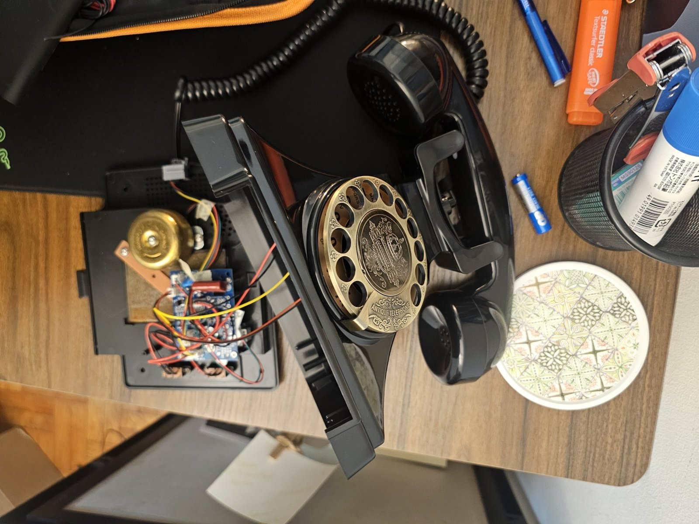 | 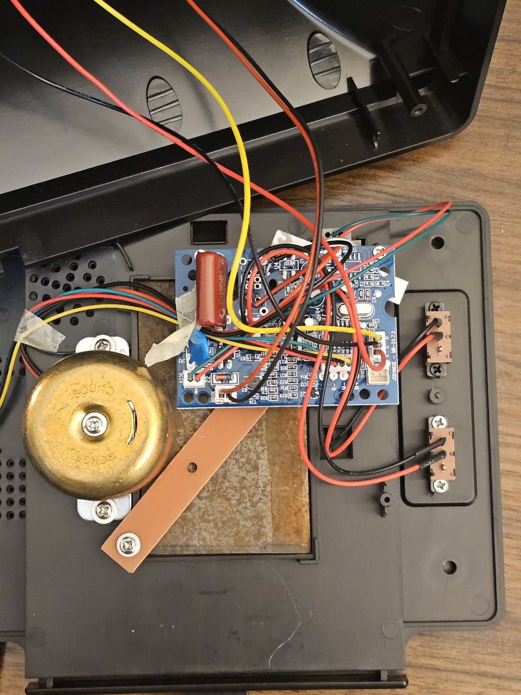 |
| 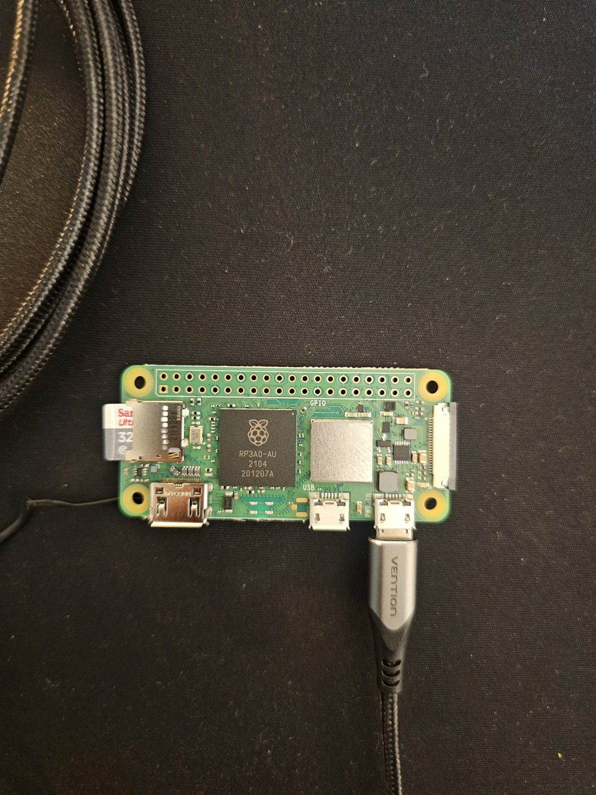 | 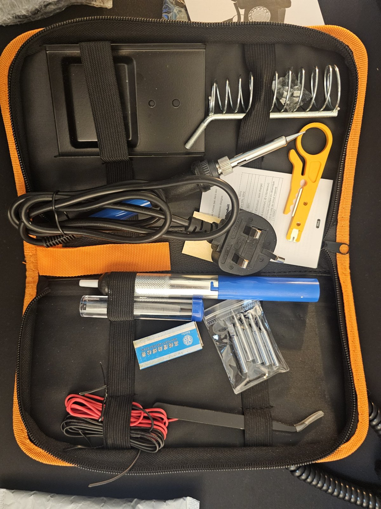 |
| 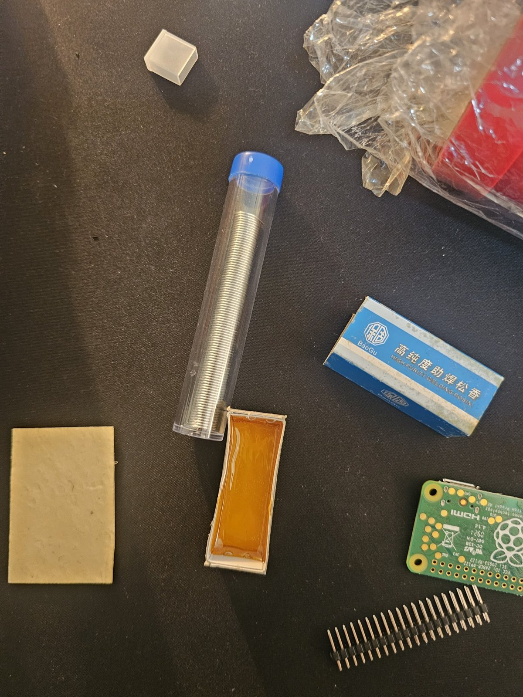 | 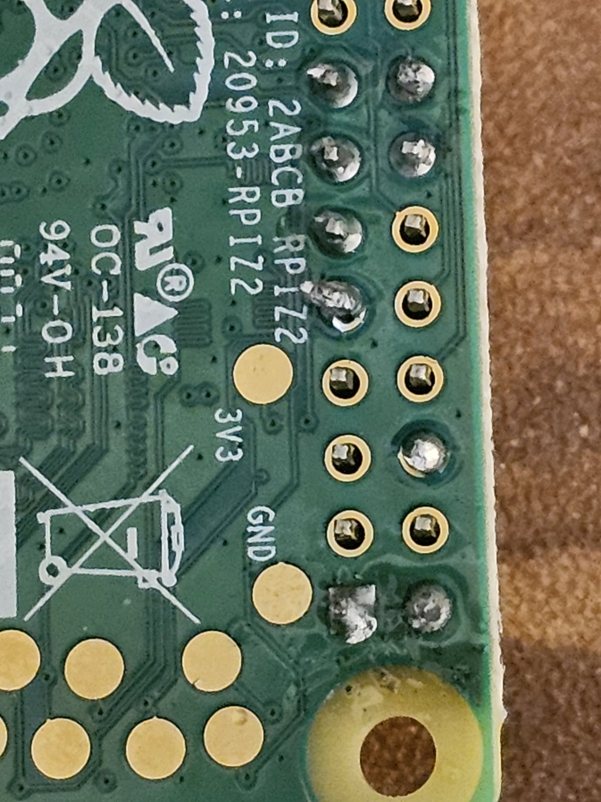 |
| 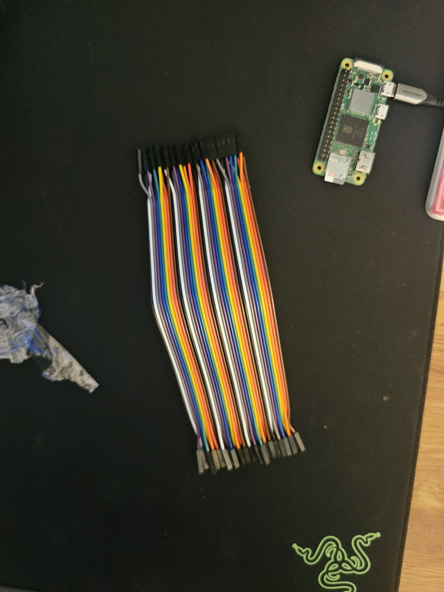 | 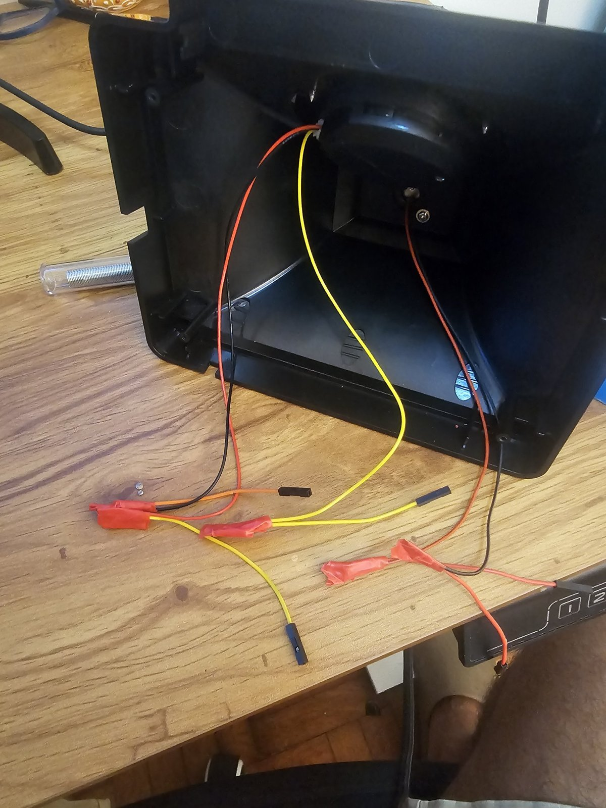 |
| 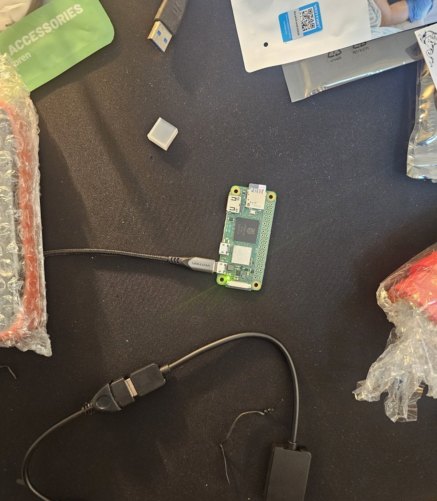 | 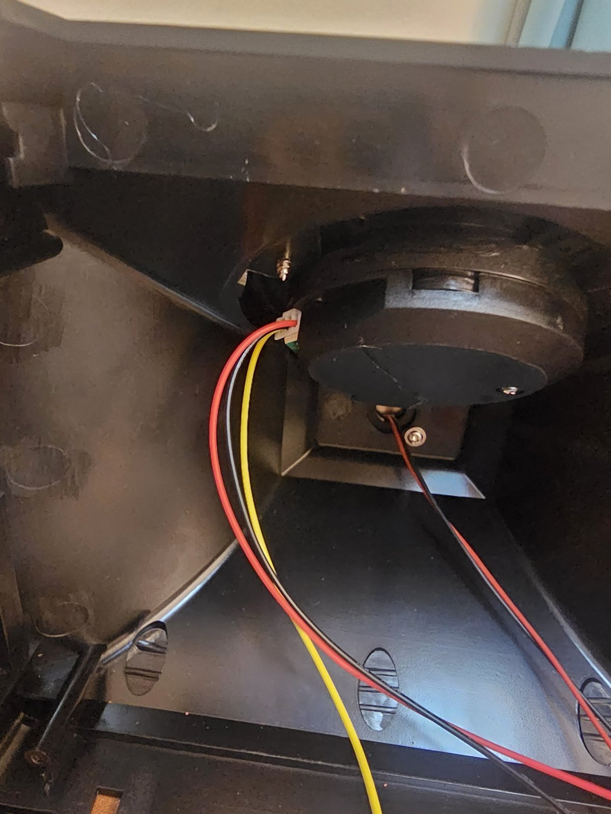 |

## 📜 License

MIT. Build one for someone you love. ❤️

Built between 11:30am and 6am, fuelled by stubbornness and coffee. ☕😴
